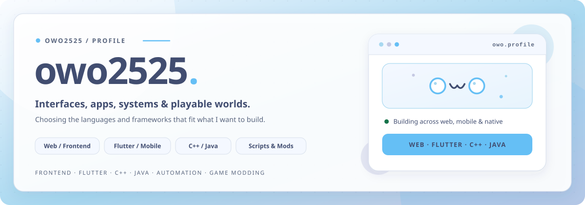

<p align="center">
  
</p>

<p align="center">
  <strong>Interfaces, apps, systems, and game worlds.</strong><br />
  From web apps, Flutter, and C++ to automation, Minecraft mods, and FiveM scripts.<br />
  I choose the languages and frameworks that fit what I want to build.
</p>

<p align="center">
  <a href="https://github.com/owo2525?tab=repositories">
    
  </a>
</p>

<br />

<p align="center">
  
</p>

Hi, I'm **owo2525**.

I build frontend interfaces, cross-platform Flutter apps, C++ and Java applications, batch jobs, automation scripts, and game extensions.

<p align="center">
  
</p>

```text
browser  →  HTML / CSS / SCSS / JavaScript / TypeScript
app      →  React / Next.js / Angular / Flutter / Node.js / Laravel / Spring
native   →  C++ / Java
data     →  SQL / MySQL / PostgreSQL
delivery →  AWS / Docker / Jenkins / GitHub / GitLab
scripts  →  Python / Shell
worlds   →  Minecraft Mod / FiveM
```

<br />

<p align="center">
  
</p>

<table>
  <tr>
    <td width="50%" valign="top">
      <h3>Frontend</h3>
      <p>
        
      </p>
      <p>
        <strong>HTML · CSS · SCSS · JavaScript · TypeScript</strong><br />
        From styling web pages to building interfaces with TypeScript.
      </p>
    </td>
    <td width="50%" valign="top">
      <h3>Frameworks &amp; State Management</h3>
      <p>
        
      </p>
      <p>
        <strong>React · Next.js · Angular · Vite · Redux · Akita</strong><br />
        Building web applications and managing application state.
      </p>
    </td>
  </tr>
  <tr>
    <td width="50%" valign="top">
      <h3>Mobile &amp; Cross-Platform</h3>
      <p>
        
      </p>
      <p>
        <strong>Flutter</strong><br />
        Building clean cross-platform applications across devices.
      </p>
    </td>
    <td width="50%" valign="top">
      <h3>Systems &amp; Native</h3>
      <p>
        
      </p>
      <p>
        <strong>C++</strong><br />
        Writing native programs and performance-focused tools.
      </p>
    </td>
  </tr>
  <tr>
    <td width="50%" valign="top">
      <h3>Java &amp; Spring</h3>
      <p>
        
      </p>
      <p>
        <strong>Java · Spring Boot · Spring Batch</strong><br />
        Developing applications and batch processing jobs.
      </p>
    </td>
    <td width="50%" valign="top">
      <h3>Backend &amp; Databases</h3>
      <p>
        
      </p>
      <p>
        <strong>Node.js · PHP · Laravel · SQL · MySQL · PostgreSQL</strong><br />
        Building server-side applications and working with databases.
      </p>
    </td>
  </tr>
  <tr>
    <td width="50%" valign="top">
      <h3>Cloud &amp; Delivery</h3>
      <p>
        
      </p>
      <p>
        <strong>AWS · Docker · Jenkins</strong><br />
        AWS: IAM / S3 / CloudFront / Lambda and more.<br />
        Working with cloud services, containers, and CI/CD automation.
      </p>
    </td>
    <td width="50%" valign="top">
      <h3>Collaboration &amp; Design</h3>
      <p>
        
      </p>
      <p>
        <strong>Git · GitHub · GitLab · Notion · Figma</strong><br />
        From version control to documentation and UI design.
      </p>
    </td>
  </tr>
  <tr>
    <td width="50%" valign="top">
      <h3>Scripting &amp; Automation</h3>
      <p>
        
      </p>
      <p>
        <strong>Python · ShellScript</strong><br />
        Writing scripts and tools to automate everyday tasks.
      </p>
    </td>
    <td width="50%" valign="top">
      <h3>Game Development</h3>
      <p>
        
      </p>
      <p>
        <strong>Minecraft Mod / Java · FiveM / Lua</strong><br />
        Bringing custom features into game worlds.
      </p>
    </td>
  </tr>
</table>

<br />

<p align="center">
  
</p>

| Area                          | Focus                                          | Stack                                                       |
| :---------------------------- | :--------------------------------------------- | :---------------------------------------------------------- |
| 🖥️ **Web interfaces**         | Web UI & state management                      | React, Next.js, Angular, Vite, Redux, Akita                 |
| 📱 **Cross-platform apps**    | Multi-platform UI & mobile applications        | Flutter                                                     |
| ⚙️ **Applications & systems** | Server-side apps, batch jobs & native programs | C++, Java, Spring Boot, Spring Batch, Node.js, Laravel      |
| 🗃️ **Data & storage**         | Data operations with SQL                       | MySQL, PostgreSQL                                           |
| ☁️ **Cloud & delivery**       | Cloud environments & development automation    | AWS, Docker, Jenkins                                        |
| 🧰 **Useful scripts**         | Tools for everyday tasks                       | Python, Shell                                               |
| 🎮 **Game extensions**        | Minecraft mods & FiveM scripts                 | Java, Lua                                                   |

<br />

<p align="center">
  
</p>
